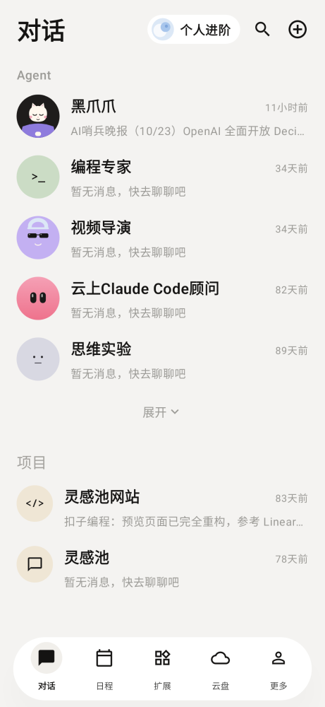
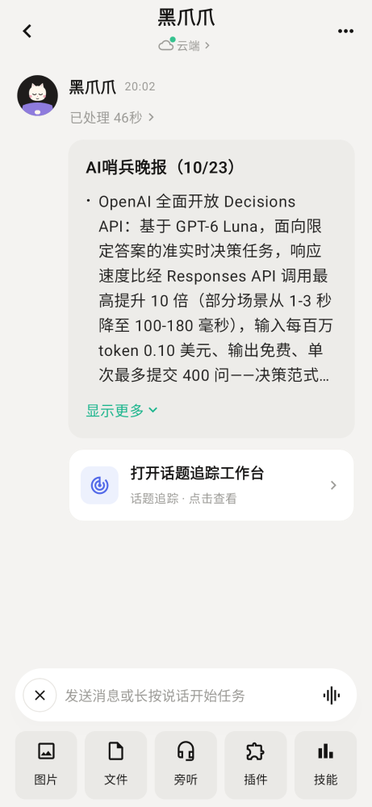
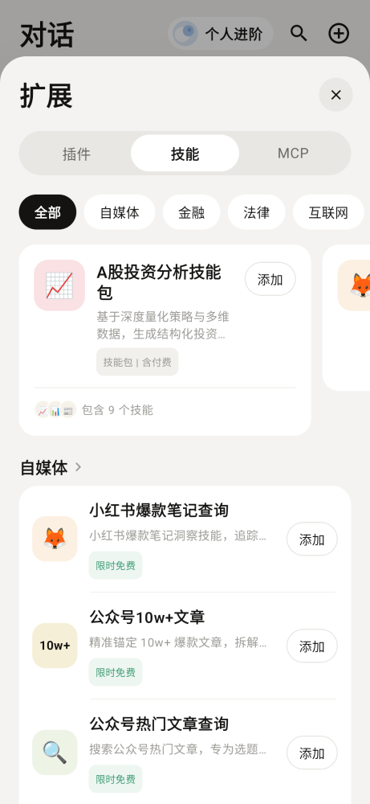
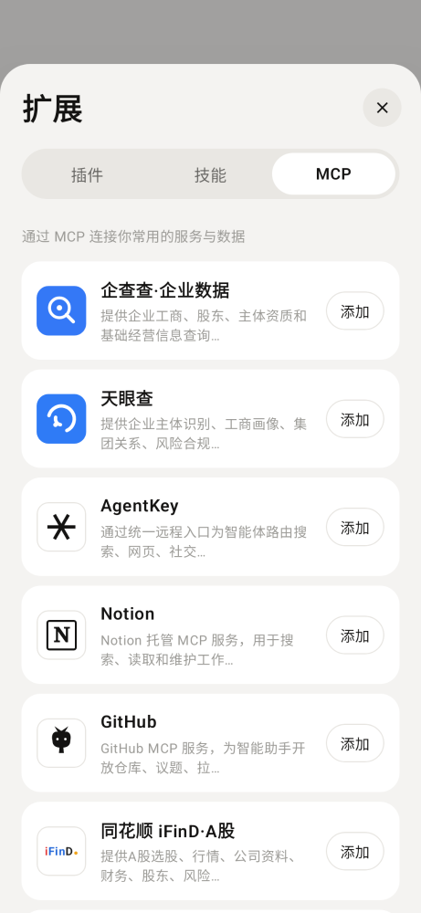
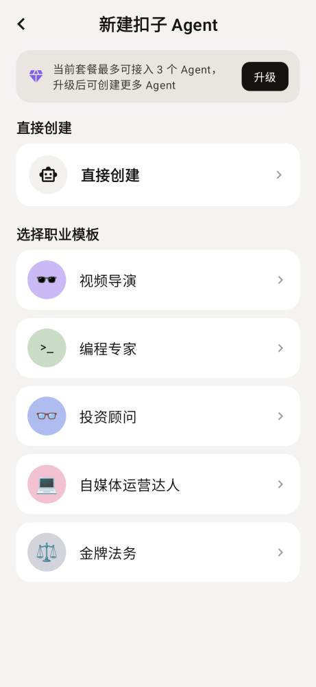

# 爪爪 · AI Agent 对话 App

用 **Kotlin + Jetpack Compose** 原生复刻的一款 AI 智能体对话应用。界面参考「扣子 / Coze」风格，包含会话首页、Agent 对话、扩展广场（插件 / 技能 / MCP）以及新建 Agent 的完整流程。

对话已接入 **OpenRouter**（OpenAI 兼容协议），支持真实模型流式回复；未配置 Key 时会在消息流中给出配置引导，不会崩溃。应用内所有头像与图标均由 Compose Canvas 手绘或使用 Material Icons，无图片素材依赖。

## 效果预览

| 对话首页 | 对话详情 | 扩展 · 技能 |
| --- | --- | --- |
|  |  |  |

| 扩展 · MCP | 新建 Agent | 新建扣子 Agent |
| --- | --- | --- |
|  |  |  |

## 已实现功能

- **对话首页**：Agent 列表、最近项目、展开/收起、搜索过滤、右上角「+」菜单、个人进阶入口。
- **对话详情**：云端 Agent 状态、长文消息卡片（`显示更多 / 收起`）、话题追踪链接卡、用户消息气泡、流式回复与「已处理 N 秒」、清空对话。
- **真实 AI 对话**：通过 OpenRouter `/chat/completions` SSE 流式返回；首包即上屏，逐字追加；请求失败显示可重试的错误卡片；401 / 402 / 429 / 超时 / 断网均有中文提示。
- **模型设置**：对话页右上角 `···` →「模型设置」，可运行时覆盖模型 ID 与 API Key（Key 输入为密码模式），保存后立即生效。
- **可取消的流式会话**：发送、重试、清空都有明确状态；清空时取消在途请求，迟到的分块不会写回已清空的会话。
- **快捷面板**：图片 / 文件 / 旁听 / 插件 / 技能五个快捷入口；插件与技能直接打开扩展面板。
- **扩展面板**：插件、技能、MCP 三个 Tab；技能分类筛选、精选技能包、添加/已添加切换；MCP 服务列表。
- **新建 Agent**：三种创建方式；扣子 Agent 支持职业模板、直接创建、名称一键换名、工作目录自动同步、描述、扩展能力多选；创建后回到首页并出现在列表顶部。
- **底部导航**：对话 / 日程 / 扩展 / 云盘 / 更多，含占位页与返回逻辑。
- **适配**：edge-to-edge、状态栏/导航栏/输入法 Insets、返回键处理、自定义弹层与页面转场动画。

## 接入 OpenRouter

### 方案选择

OpenRouter 完全兼容 OpenAI 的 `/v1/chat/completions` 协议，只替换 Base URL（`https://openrouter.ai/api/v1/`）与 Bearer Token 即可。因此不需要手写 SSE 解析。

选用 **[aallam/openai-kotlin](https://github.com/aallam/openai-kotlin)** `4.1.0`：

- Kotlin Multiplatform / Kotlin-first，协程 `Flow<ChatCompletionChunk>` 原生流式，接口与 Compose 状态层契合。
- 支持自定义 `OpenAIHost(baseUrl = ...)`，直接指向 OpenRouter。
- 网络引擎可选 Ktor OkHttp（`io.ktor:ktor-client-okhttp:3.0.0`），Android 上成熟稳定。
- 对比官方 `openai-java`（JVM 优先、体积与配置更重）与手写 OkHttp SSE（可控但需自己处理分块、重连、异常），该 SDK 在 Android 上的综合成本最低。

集成点集中在 `network/OpenRouter.kt`：`OpenRouterClient` 只做「SDK 请求 → 文本流」的适配，`OpenRouterRepository` 负责系统提示词与历史裁剪（最近 12 条、单条截断 6000 字符、过滤错误消息）。

### 配置方式

在项目根目录 `local.properties` 中写入（该文件已被 `.gitignore` 排除，不会进入源码包）：

```properties
sdk.dir=/path/to/Android/Sdk
OPENROUTER_API_KEY=sk-or-v1-你的Key
OPENROUTER_MODEL=openrouter/free
OPENROUTER_BASE_URL=https://openrouter.ai/api/v1/
```

构建时通过 `BuildConfig` 注入；也可用同名环境变量。`OPENROUTER_MODEL` 可换成任意 OpenRouter 模型 ID，例如 `openai/gpt-4o-mini`、`google/gemini-2.0-flash-001`、`anthropic/claude-3.5-haiku` 等。

运行时也可以在 App 内「模型设置」中覆盖 Key 与模型（保存在 `SharedPreferences`，仅适合本机试验）。

### 免费额度与模型

- 免费模型每天有请求次数上限（当前账号为 50 次/天），额度与 Key 有效期以 OpenRouter 控制台为准。
- 默认 `openrouter/free` 会自动路由到可用免费模型；不同模型对 `max_tokens` 的处理不同，推理型模型在预算过小时可能只返回 reasoning 而没有正文。本项目已设置 `max_tokens = 1024`、`temperature = 0.7`，并对「无正文」给出错误提示，可重试。
- 若遇到 `429`，多为上游免费模型限流，稍后重试或换模型即可。

## 架构重构（v1.2）

对话行为从 `AppViewModel` 收进一个深模块 `chat/ChatConversation.kt`：

- 外部只看到 `state / send / retry / clear` 四个入口，内部负责流式缓冲、首包等待、取消、代次隔离与「已处理 N 秒」。
- 模型侧只暴露 `ReplySource` 一个缝：生产环境是 `OpenRouterRepository`，测试用内存假实现。接口即测试面，不需要 Android 或真实网络。
- `AppViewModel` 只保留页面栈、Agent 列表、预览摘要和设置委托；`ChatScreen` 通过 `StateFlow<ChatState>` 观察消息与阶段。
- 对话页拆成 `ChatScreen`（布局与输入）、`ChatThread`（消息与滚动）、`ChatHeader`（菜单）、`OpenRouterSettingsDialog`（配置）四个模块，各自只为一类变化负责。
- 领域词表见 [GLOSSARY.md](GLOSSARY.md)，决策记录见 [docs/adr/0001-conversation-module.md](docs/adr/0001-conversation-module.md)。

重构后的会话逻辑由 7 个接口级测试与 8 个 Paparazzi 快照覆盖，真实 OpenRouter 联调保持通过。

## 技术栈

- Kotlin 2.0.21 / Jetpack Compose（BOM 2024.10.01）/ Material 3
- 单 Activity + Compose，`BackHandler` + `AnimatedContent` 自建页面栈
- `AppViewModel` 管理页面栈与列表；`ChatConversation` 管理单段会话，`StateFlow` 驱动 UI
- OpenRouter 接入：`com.aallam.openai:openai-client:4.1.0` + `io.ktor:ktor-client-okhttp:3.0.0`
- AGP 8.7.3 / Gradle 8.10.2 / JDK 17 / compileSdk 35 / minSdk 26
- Paparazzi 1.3.5 离屏截图测试 + `kotlinx-coroutines-test` 会话接口测试

## 运行

1. 安装 Android Studio（Ladybug 或更新版本）与 Android SDK Platform 35。
2. 用 Android Studio 打开项目根目录，等待 Gradle 同步。
3. 在 `local.properties` 填入 `OPENROUTER_API_KEY`（可选，也可进 App 后再配置）。
4. 选择 API 26 及以上的设备或模拟器，点击 Run。

命令行构建：

```bash
# 在项目根目录创建 local.properties，写入 SDK 路径与 OpenRouter Key
cat > local.properties <<'EOF'
sdk.dir=/path/to/Android/Sdk
OPENROUTER_API_KEY=sk-or-v1-你的Key
OPENROUTER_MODEL=openrouter/free
EOF

./gradlew :app:assembleDebug
# 产物：app/build/outputs/apk/debug/app-debug.apk

./gradlew :app:installDebug
```

## 测试

```bash
# 会话接口测试 + 快照 + Repository 提示词/历史裁剪单测
./gradlew :app:testDebugUnitTest

# 真实调用 OpenRouter 的联调测试（会消耗额度，需显式开启）
OPENROUTER_LIVE_TEST=1 ./gradlew :app:testDebugUnitTest --tests '*OpenRouterLiveTest*'
```

快照报告位于 `app/build/reports/paparazzi/debug/index.html`。`ChatConversationTest` 覆盖流式首包、busy、429、重试、清空取消、历史传递和缺 Key 七类行为；`OpenRouterLiveTest` 使用与 App 相同的 SDK 与配置验证 Key、网络与流式返回链路。

## 目录结构

```
app/src/main/java/com/qoder/clawagent/
├── MainActivity.kt          # 入口，edge-to-edge 配置，VM Factory 注入
├── AppViewModel.kt          # 页面栈、Agent/项目列表、会话编排
├── chat/
│   └── ChatConversation.kt  # 单段会话：流式、重试、清空、错误映射
├── data/SampleData.kt       # 演示数据
├── model/Models.kt          # 数据模型与页面路由
├── network/OpenRouter.kt    # SDK 适配、配置存取、提示词组装
└── ui/
    ├── ClawApp.kt           # 根组件、转场与返回处理
    ├── Avatars.kt           # Canvas 手绘头像 / MCP 图标
    ├── Common.kt            # 通用组件与虚线边框
    ├── theme/Theme.kt       # 配色与 Material 主题
    └── screens/
        ├── ChatScreen.kt    # 对话页布局与输入区
        ├── ChatThread.kt    # 消息列表、卡片与滚动跟随
        ├── ChatHeader.kt    # 顶栏与更多菜单
        ├── OpenRouterSettingsDialog.kt
        └── ...              # 首页 / 扩展 / 新建 Agent / 占位 Tab
```

## 安全说明

- 本工程为本地试验项目，API Key 会编译进 debug APK 的 `BuildConfig`，也可以被同一设备的 `SharedPreferences` 读取。**请勿分发含真实 Key 的 APK，也不要提交 `local.properties`。**
- 如果 Key 曾进入截图、日志或公开仓库，请到 OpenRouter 控制台立即吊销并重新生成。
- 正式产品应通过自建后端代理调用模型，客户端只持有短期会话凭证，避免 Key 落到终端。

## 说明

除 OpenRouter 对话外，图片/文件选择、语音旁听、登录与套餐升级仍为本地演示或 Toast 提示；扩展广场与新建 Agent 为完整交互演示，未接真实后端。演示数据位于 `SampleData.kt`，可自行替换。
