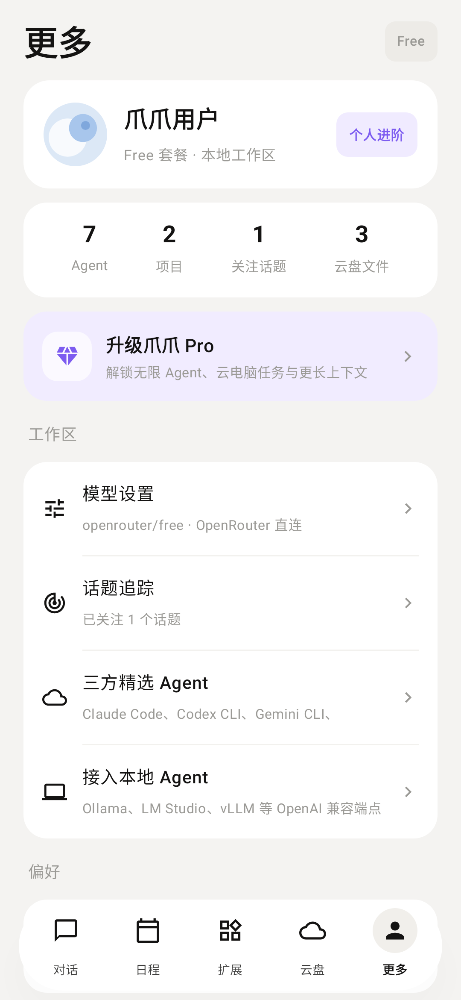
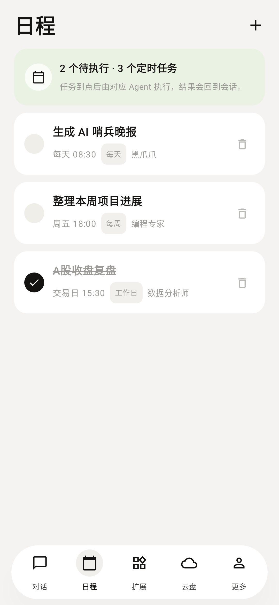
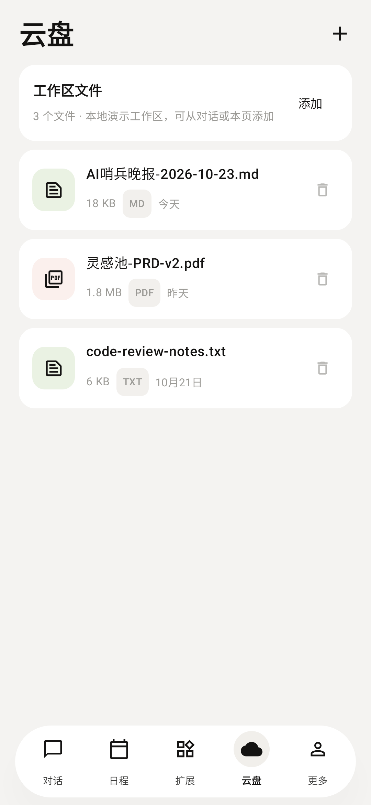
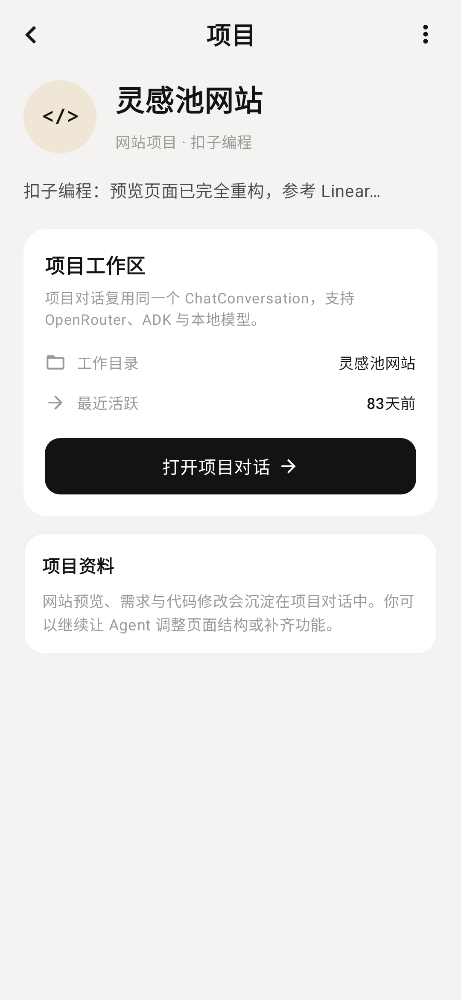
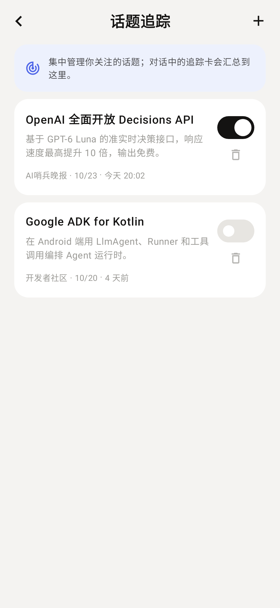
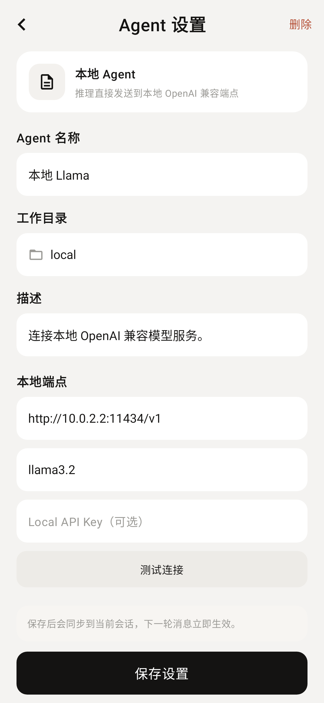
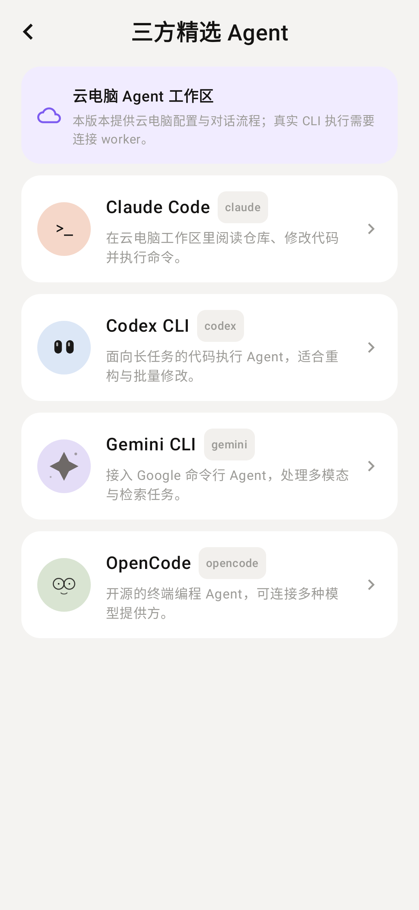
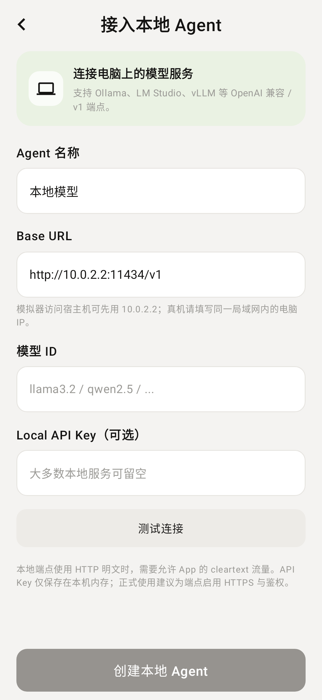
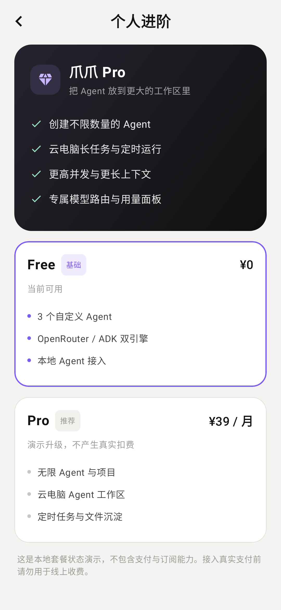

# 爪爪 · AI Agent 对话 App

用 **Kotlin + Jetpack Compose** 原生开发的一款 AI 智能体对话应用，界面参考「扣子 / Coze」风格。首页、对话、项目、日程、云盘、扩展广场、Agent 管理与个人中心均已打通，不是静态样稿。

对话接入了 **OpenRouter**（OpenAI 兼容协议），并把 **Google ADK for Kotlin** 作为第二套推理引擎接进同一条 `ReplySource` 接缝；此外可以为每个 Agent 配置 **本地 OpenAI 兼容端点**（Ollama / LM Studio / vLLM）。未配置 Key 时会在消息流中给出配置引导，不会崩溃。所有头像与图标均由 Compose Canvas 手绘或使用 Material Icons，无图片素材依赖。

当前版本：**v1.4（versionCode 5）**

仓库地址：<https://github.com/xiaopengs/ClawAgent>

直接下载：[`release/ClawAgent-v1.4-debug.apk`](https://github.com/xiaopengs/ClawAgent/raw/main/release/ClawAgent-v1.4-debug.apk)（约 38 MB，空 Key debug 包，API 26+；安装后在「模型设置」填入自己的 Key）。校验值与安装说明见 [`release/README.md`](release/README.md)。

## 效果预览

<table>
  <tr>
    <td align="center"><br>对话首页</td>
    <td align="center"><br>Agent 对话</td>
    <td align="center"><br>更多 · 个人进阶</td>
    <td align="center"><br>日程</td>
  </tr>
  <tr>
    <td align="center"><br>云盘</td>
    <td align="center"><br>项目详情</td>
    <td align="center"><br>话题追踪</td>
    <td align="center"><br>Agent 设置</td>
  </tr>
  <tr>
    <td align="center"><br>三方精选 Agent</td>
    <td align="center"><br>接入本地 Agent</td>
    <td align="center"><br>个人进阶 / 套餐</td>
    <td align="center"><br>扩展 · 插件</td>
  </tr>
</table>

其余截图（技能、MCP、新建 Agent、扣子模板、配置表单）见 [`docs/screenshots/`](docs/screenshots/)。全部 17 张截图由 Roborazzi + Robolectric 在 JVM 上离屏生成，分辨率 1080×2340，不依赖模拟器。

## 架构


四层结构：

- **UI**：`ClawApp` 管页面栈与转场；首页、对话、项目、日程、云盘、扩展、个人中心各自独立；`ChatHeader`、`ChatThread` 与输入区拆分。
- **应用与领域**：`AppViewModel` 负责导航、Agent / 项目 / 日程 / 云盘状态和预览摘要；`ChatConversation` 是唯一会话状态源，对外只有 `state / send / retry / clear`；它依赖 `ReplySource` 接口，不关心网络实现。
- **适配器**：`OpenRouterRepository` 直连 OpenRouter SSE；`AdkReplySource` 用 ADK 的 `LlmAgent + InMemoryRunner + ChatCompletions` 运行 Agent；`LocalReplySource` 直连用户配置的 `/v1` 兼容端点。三种运行时共用同一套提示词、历史裁剪与附件序列化。
- **配置与存储**：`OpenRouterSettingsStore`（Prefs / InMemory）保存 `key · model · baseUrl · engine`，每次流式请求实时读取；构建期默认值来自 `local.properties` 注入的 `BuildConfig`。

设计词表见 [GLOSSARY.md](GLOSSARY.md)，决策记录见 [0001-conversation-module](docs/adr/0001-conversation-module.md) 与 [0002-adk-engine](docs/adr/0002-adk-engine.md)。

## 已实现功能

逐项核对表（含演示边界与测试证据）见 [docs/FEATURE-AUDIT.md](docs/FEATURE-AUDIT.md)。

### 对话与项目

- **对话首页**：Agent 列表、最近项目、展开 / 收起、搜索过滤、右上角「+」菜单、个人进阶入口。
- **项目工作区**：新建通用 / 网站项目；每个项目复用一条隐藏的 `ChatConversation`，项目详情可打开项目对话；项目不会混入 Agent 列表。
- **真实 AI 对话**：SSE 流式返回，首包即上屏；请求失败显示可重试的错误卡片；401 / 402 / 429 / 超时 / 断网均有中文提示。
- **双云引擎**：模型设置中可在「直连 OpenRouter」与「ADK Agent」之间切换，保存后立即生效。
- **ADK Agent**：每轮新建内存会话并回放可见历史，流式读取 ADK 事件；注册了 `get_local_time` 函数工具，作为 ADK 工具调用的最小示例。
- **长文消息卡片**：「显示更多 / 收起」、用户消息气泡、话题追踪链接卡、流式回复与「已处理 N 秒」、清空对话。
- **可取消的流式会话**：发送、重试、清空都有明确状态；清空时取消在途请求，迟到的分块不会写回已清空的会话。
- **工作区与处理详情**：点击顶部状态查看运行时、模型、工作目录、端点与扩展；点击「已处理」查看耗时、模型、引擎、输出字数与附件数。
- **多模态附件**：最多 6 个附件；图片可多选 4 张，读取后等比缩放到 1280px、JPEG 82% 并转换为 data URL；文本类文件读取前 16 KB 拼入提示词；附件快照会随消息保存，重试 / 切换引擎后仍可用。
- **语音输入与旁听**：运行时申请 `RECORD_AUDIO`；「语音输入」把识别文本放回输入框；「旁听」持续收音，结束后作为消息发送；均处理无识别服务、权限拒绝与重新收音。
- **话题追踪**：从对话中的追踪卡或「更多」进入；新增 / 开关 / 删除话题，展示来源、时间与摘要。

### Agent 与扩展

- **新建 Agent**：直接创建、扣子模板、三方精选三条路径；扣子 Agent 支持职业模板、名称一键换名、工作目录同步、描述、扩展能力多选。
- **Agent 设置**：编辑名称、工作目录、描述；本地 Agent 可改端点、模型与 API Key，并通过 `GET /models` 实际探测；保存后同步到当前会话，下一轮立即生效；自定义 Agent 可删除。
- **三方精选 Agent**：Claude Code、Codex CLI、Gemini CLI、OpenCode 的配置与对话流程；界面明确标注真实 CLI 执行需要连接 worker，避免把配置页伪装成执行环境。
- **本地 Agent**：支持 Ollama / LM Studio / vLLM 等 OpenAI 兼容 `/v1` 端点；提供模拟器 `10.0.2.2` 提示、可选 API Key、连接测试与模型列表选择。
- **扩展广场**：插件、技能、MCP 三个 Tab；技能分类筛选、精选技能包、添加 / 已添加切换；MCP 服务列表。

### 日程、云盘与个人中心

- **日程**：新增定时任务（标题、时间、重复、执行 Agent）、完成 / 取消完成、删除、空状态；任务配置保存在本地，真正定时执行需接入云端 worker。
- **云盘（本地演示）**：从系统文件选择器添加文件、显示类型 / 大小 / 时间、文本预览、调用系统应用打开、删除、空状态。
- **个人中心**：账号卡、统计（Agent / 项目 / 关注话题 / 云盘文件）、Free / Pro 状态、模型设置、话题追踪、三方 Agent、本地 Agent、通知开关、帮助 / 关于、版本号。
- **套餐页**：Free / Pro 权益对比与本地演示升级，明确提示不包含支付与订阅，不会产生真实扣费。
- **底部导航**：对话 / 日程 / 扩展 / 云盘 / 更多，带选中态与返回逻辑。
- **适配**：edge-to-edge、状态栏 / 导航栏 / 输入法 Insets、返回键处理、自定义弹层与页面转场动画。

## 三种运行时

| | 直连 OpenRouter | ADK Agent | 本地 Agent |
| --- | --- | --- | --- |
| 实现 | `OpenRouterRepository` | `AdkReplySource` | `LocalReplySource` |
| 协议 | aallam `openai-client` 4.1.0 + Ktor OkHttp，SSE | ADK 1.4.0 `ChatCompletions` 后端 | 同一 SDK，自定义 Base URL |
| 状态 | `ChatConversation` | `ChatConversation` | `ChatConversation` |
| 配置 | 全局模型设置 | 全局模型设置 + 引擎切换 | 每个 Agent 独立端点 / 模型 / Key |
| 附件 | 文本 + 图片 data URL | `Part(text)` + `Part(inlineData)` | 文本 + 图片 data URL |
| 适用 | 轻量、依赖少、首包直接透传 | 工具调用、Runner、事件流 | 局域网 / 本机模型 |

云引擎切换方式：对话页右上角 `···` →「模型设置」→ 选择「直连 OpenRouter / ADK Agent」→ 保存。引擎选择与 Key、模型一起持久化在 `SharedPreferences`。

ADK 路径的关键取舍：

- **每轮一个 `InMemoryRunner` 会话**，把当前可见历史回放成事件。这样 `ChatConversation` 始终是唯一事实来源，清空 / 重试语义与直连引擎完全一致；代价是没有跨进程的持久会话。
- **优先消费 partial 事件**，逐块上屏；若兼容端点不返回增量，则在结束时一次性发出最终聚合文本。
- **模型仍是 OpenRouter**，通过 ADK 的 OpenAI 兼容 `ChatCompletions` + `HttpOptions(baseUrl = ...)` 接入，所以只需要维护一套凭证和模型设置。

## 接入 ADK Kotlin：可行性结论

**可以接入，但不是 drop-in。** v1.3 起已实际集成并通过编译、单测和一次真实流式联调。约束如下：

| 项目 | v1.2 | v1.4 | 原因 |
| --- | --- | --- | --- |
| Kotlin | 2.0.21 | **2.3.21** | ADK 1.4.0 拉起 Ktor 3.6.0，其 metadata 由 Kotlin 2.3.21 编译 |
| AGP | 8.7.3 | **8.13.2** | 需要解析 `compileSdk 37`；AGP 9 内置 Kotlin 2.2.10，仍读不了 2.3 metadata |
| Gradle | 8.10.2 | **8.14.6** | 与 AGP 8.13.2 配套 |
| compileSdk | 35 | **37** | ADK 的 Android AAR 声明 `minCompileSdk=37` |
| targetSdk / minSdk | 35 / 26 | 35 / 26 | 不变 |
| 截图测试 | Paparazzi 1.3.5 | **Roborazzi 1.77.0 + Robolectric 4.17** | Paparazzi 尚不支持 compileSdk 37 / AGP 8.13.2 |
| debug APK | ~19 MB | **~38 MB** | ADK + Google auth / transport 依赖 |

依赖坐标：

```kotlin
implementation("com.google.adk:google-adk-kotlin-core:1.4.0")
implementation("com.google.adk:google-adk-kotlin-integrations-openai:1.4.0")
```

`gradle.properties` 中的 `android.suppressUnsupportedCompileSdk=37` 仅用于压掉 AGP 的版本提示，不代表已获得官方支持；升级 AGP 后应移除。完整背景与后果见 [ADR 0002](docs/adr/0002-adk-engine.md)。

如果只需要普通流式对话，直连引擎更轻；只有在需要工具调用、Runner 或事件模型时，ADK 的体积和工具链升级才值得。

## 接入 OpenRouter

### 方案选择

OpenRouter 完全兼容 OpenAI 的 `/v1/chat/completions` 协议，只替换 Base URL（`https://openrouter.ai/api/v1/`）与 Bearer Token 即可。因此不需要手写 SSE 解析。

选用 **[aallam/openai-kotlin](https://github.com/aallam/openai-kotlin)** `4.1.0`：

- Kotlin Multiplatform / Kotlin-first，协程 `Flow<ChatCompletionChunk>` 原生流式，接口与 Compose 状态层契合。
- 支持自定义 `OpenAIHost(baseUrl = ...)`，直接指向 OpenRouter 或本地端点。
- 网络引擎可选 Ktor OkHttp，Android 上成熟稳定。
- 对比官方 `openai-java`（JVM 优先、体积与配置更重）与手写 OkHttp SSE（可控但需自己处理分块、重连、异常），该 SDK 在 Android 上的综合成本最低。

集成点集中在 `network/OpenRouter.kt`：`OpenRouterClient` 只做「SDK 请求 → 文本流」的适配，`OpenRouterRepository` 负责系统提示词与历史裁剪（最近 12 条、单条截断 6000 字符、过滤错误消息）。ADK 与本地适配器复用同一套提示词与裁剪规则。

### 配置方式

在项目根目录 `local.properties` 中写入（该文件已被 `.gitignore` 排除，不会进入源码包）：

```properties
sdk.dir=/path/to/Android/Sdk
OPENROUTER_API_KEY=sk-or-v1-你的Key
OPENROUTER_MODEL=openrouter/free
OPENROUTER_BASE_URL=https://openrouter.ai/api/v1/
```

构建时通过 `BuildConfig` 注入；也可用同名环境变量。`OPENROUTER_MODEL` 可换成任意 OpenRouter 模型 ID，例如 `openai/gpt-4o-mini`、`google/gemini-2.0-flash-001`、`anthropic/claude-3.5-haiku` 等。

运行时也可以在 App 内「模型设置」中覆盖 Key 与模型（保存在 `SharedPreferences`，仅适合本机试验）。

### 免费额度与模型

- 免费模型每天有请求次数上限（以 OpenRouter 控制台为准）。
- 默认 `openrouter/free` 会自动路由到可用免费模型；不同模型对 `max_tokens` 的处理不同，推理型模型在预算过小时可能只返回 reasoning 而没有正文。本项目设置 `max_tokens = 1024`、`temperature = 0.7`，并对「无正文」给出错误提示，可重试。
- 若遇到 `429`，多为上游免费模型限流，稍后重试或换模型即可。

## 技术栈

- Kotlin **2.3.21** / Jetpack Compose（BOM 2024.10.01）/ Material 3
- 单 Activity + Compose，`BackHandler` + `AnimatedContent` 自建页面栈
- `AppViewModel` 管理页面栈与列表；`ChatConversation` 管理单段会话，`StateFlow` 驱动 UI
- OpenRouter 接入：`com.aallam.openai:openai-client:4.1.0` + `io.ktor:ktor-client-okhttp:3.0.0`
- ADK 接入：`com.google.adk:google-adk-kotlin-core:1.4.0` + `integrations-openai:1.4.0`
- Android 系统能力：`PickMultipleVisualMedia`、`OpenDocument`、`SpeechRecognizer` / `RecognizerIntent`、`ACTION_VIEW`
- AGP **8.13.2** / Gradle **8.14.6** / JDK 17 字节码（构建实测 JDK 21）/ compileSdk **37** / targetSdk 35 / minSdk 26
- Roborazzi 1.77.0 + Robolectric 4.17 离屏截图测试；`kotlinx-coroutines-test` 会话接口测试

## 运行与构建

环境要求：

- JDK 17 或更高（本项目在 JDK 21 上构建与测试）
- Android SDK Platform 37、Build Tools 37.0.0
- Android Studio Ladybug 或更新版本（需支持 compileSdk 37）

```bash
# 在项目根目录创建 local.properties，写入 SDK 路径与 OpenRouter Key
cat > local.properties <<'EOF'
sdk.dir=/path/to/Android/Sdk
OPENROUTER_API_KEY=sk-or-v1-你的Key
OPENROUTER_MODEL=openrouter/free
OPENROUTER_BASE_URL=https://openrouter.ai/api/v1/
EOF

./gradlew :app:assembleDebug
# 产物：app/build/outputs/apk/debug/app-debug.apk

./gradlew :app:installDebug
```

也可以直接用 Android Studio 打开项目根目录，等待 Gradle 同步后运行。支持 API 26 及以上的设备或模拟器；本地 Agent 在模拟器访问宿主机时使用 `http://10.0.2.2:<port>/v1`，真机填写同一局域网内的电脑 IP。使用 HTTP 明文端点依赖 Manifest 中的 `usesCleartextTraffic`；正式环境建议启用 HTTPS 与鉴权。

## 测试与截图

```bash
# 39 个确定性测试 + 2 个可选联调（未开启时跳过）
./gradlew :app:testDebugUnitTest

# 重新生成 17 张截图
./gradlew :app:recordRoborazziDebug

# 真实调用 OpenRouter 的联调测试（会消耗额度，需显式开启）
OPENROUTER_LIVE_TEST=1 ./gradlew :app:testDebugUnitTest --tests '*OpenRouterLiveTest*'
OPENROUTER_LIVE_TEST=1 ./gradlew :app:testDebugUnitTest --tests '*AdkLiveTest*'
```

当前测试分布：`ChatConversationTest` 9、`OpenRouterRepositoryTest` 5、`AppViewModelTest` 6、`AdkReplySourceTest` 2、`ScreenshotTest` 17；另有 `OpenRouterLiveTest` / `AdkLiveTest` 各 1，默认跳过。

- 截图输出：`app/build/outputs/roborazzi/*.png`，同时复制到 `docs/screenshots/` 供 README 使用。
- Roborazzi 报告：`app/build/reports/roborazzi/debug/index.html`。
- 单测报告：`app/build/reports/tests/testDebugUnitTest/index.html`。
- `ChatConversationTest` 覆盖流式首包、busy、429、重试、清空取消、历史传递、附件消息、Agent 配置同步和缺 Key。
- `AppViewModelTest` 覆盖项目隐藏 Agent 复用、重命名 / 删除同步、本地与三方配置、可见性保持、种子数据保护和套餐切换。
- `AdkReplySourceTest` 覆盖缺 Key 与空历史；`AdkLiveTest` 通过 Robolectric 在 JVM 上真实跑一次 ADK → OpenRouter → SSE 链路。

## 目录结构

```
app/src/main/java/com/qoder/clawagent/
├── MainActivity.kt              # 入口，edge-to-edge 配置，VM Factory 注入
├── AppViewModel.kt              # 页面栈、Agent/项目/日程/云盘、运行时路由
├── chat/
│   ├── ChatConversation.kt      # 单段会话：流式、重试、清空、错误映射 + ReplySource 接缝
│   ├── ChatFailures.kt          # 错误类型与提示文案
│   ├── ReplyEngine.kt           # OPENROUTER | ADK
│   └── AgentPrompt.kt           # 三种运行时共用的系统提示词
├── data/SampleData.kt           # 演示数据
├── model/Models.kt              # 数据模型与页面路由
├── network/
│   ├── OpenRouter.kt            # 直连 SDK、配置存取、历史裁剪、本地端点探测与 LocalReplySource
│   └── AdkReplySource.kt        # ADK Runner / Session / FunctionTool 适配
├── util/Attachments.kt          # 图片缩放 / data URL、文本截断、文件元数据
└── ui/
    ├── ClawApp.kt               # 根组件、转场与返回处理
    ├── Avatars.kt               # Canvas 手绘头像 / MCP 图标
    ├── Common.kt                # 通用组件与底部导航
    ├── theme/Theme.kt           # 配色与 Material 主题
    └── screens/
        ├── ChatScreen.kt        # 对话页、附件 / 语音 / 弹层
        ├── ChatThread.kt        # 消息列表、附件气泡与滚动跟随
        ├── ChatHeader.kt        # 顶栏与更多菜单
        ├── ChatDialogs.kt       # 工作区 / 已处理 / 语音收音
        ├── AgentSettingsScreen.kt
        ├── ThirdPartyAgentsScreen.kt
        ├── LocalAgentScreen.kt
        ├── ScheduleScreen.kt
        ├── DriveScreen.kt
        ├── ProfileScreen.kt
        ├── ProjectDetailScreen.kt
        ├── TopicTrackingScreen.kt
        ├── UpgradeScreen.kt
        └── ...                  # 首页 / 扩展 / 新建 Agent
```

```text
app/src/test/java/com/qoder/clawagent/
├── ChatConversationTest.kt      # 领域行为，纯 JVM
├── OpenRouterTest.kt            # 配置持久化 + 提示词组装 + 多模态 + 本地端点
├── AppViewModelTest.kt          # 项目 / Agent / 本地配置 / 套餐
├── AdkReplySourceTest.kt        # ADK 适配器失败路径
├── OpenRouterLiveTest.kt        # 可选：真实直连
├── AdkLiveTest.kt               # 可选：真实 ADK 链路
└── ScreenshotTest.kt            # 17 张 Roborazzi 快照
```

## 版本记录

- **v1.4**：逐项补齐界面功能点——附件（图片 / 文件）、语音输入 / 旁听、日程、云盘、项目详情、话题追踪、Agent 设置、三方 Agent、本地 Agent、个人中心与套餐页；新增 9 张截图与 `AppViewModelTest`，测试总数 41。
- **v1.3**：接入 ADK Kotlin 作为第二引擎；工具链升级到 Kotlin 2.3.21 / AGP 8.13.2 / compileSdk 37；Paparazzi 替换为 Roborazzi；建立 Git 仓库、README、架构图和 ADR。
- **v1.2**：把会话行为收进 `ChatConversation` 深模块，引入 `ReplySource` 接缝；拆分对话页；补齐接口级测试。
- **v1.1**：接入 OpenRouter 流式对话、模型设置与错误提示。
- **v1.0**：用 Compose 复刻参考稿的界面与交互流程。

## 安全说明

- 本工程为本地试验项目，API Key 会编译进 debug APK 的 `BuildConfig`，也可以被同一设备的 `SharedPreferences` 读取。**请勿分发含真实 Key 的 APK，也不要提交 `local.properties`。**
- 如果 Key 曾进入截图、日志或公开仓库，请到 OpenRouter 控制台立即吊销并重新生成。
- 本地 Agent 的 API Key 仅保存在当前进程内存中；端点使用 HTTP 明文时请只在可信局域网内试验。
- 正式产品应通过自建后端代理调用模型，客户端只持有短期会话凭证，避免 Key 落到终端。

## 说明

三方 Agent 页面提供配置、会话与入口，真实 CLI 执行需要外部 worker，界面中已明确标注。定时任务的调度、套餐升级、通知开关、账号资料与帮助 / 关于为本地状态演示；插件、技能与 MCP 为完整的交互演示，未接真实后端。演示数据位于 `SampleData.kt`，可自行替换。
