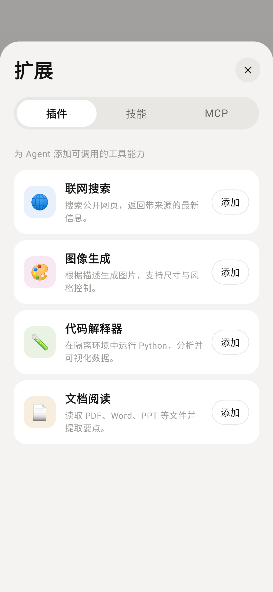
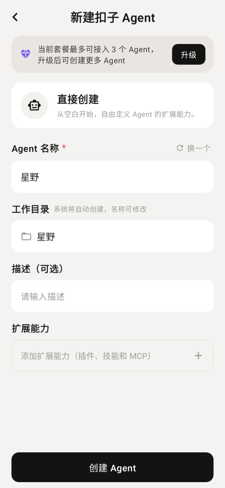
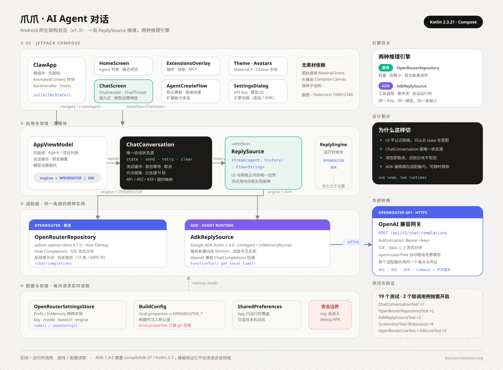

# 爪爪 · AI Agent 对话 App

用 **Kotlin + Jetpack Compose** 原生复刻的一款 AI 智能体对话应用，界面参考「扣子 / Coze」风格。包含会话首页、Agent 对话、扩展广场（插件 / 技能 / MCP）与新建 Agent 的完整流程。

对话已接入 **OpenRouter**（OpenAI 兼容协议），并在 v1.3 把 **Google ADK for Kotlin** 作为第二套推理引擎接进同一条 `ReplySource` 接缝：既可以直接流式调用 OpenRouter，也可以让 ADK 的 `LlmAgent` 带着工具运行。未配置 Key 时会在消息流中给出配置引导，不会崩溃。所有头像与图标均由 Compose Canvas 手绘或使用 Material Icons，无图片素材依赖。

当前版本：**v1.3（versionCode 4）**

仓库地址：<https://github.com/xiaopengs/ClawAgent>

## 效果预览

<table>
  <tr>
    <td align="center"><br>对话首页</td>
    <td align="center"><br>Agent 对话</td>
    <td align="center"><br>扩展 · 技能</td>
    <td align="center"><br>扩展 · 插件</td>
  </tr>
  <tr>
    <td align="center"><br>扩展 · MCP</td>
    <td align="center"><br>新建 Agent</td>
    <td align="center"><br>扣子 Agent 模板</td>
    <td align="center"><br>Agent 配置表单</td>
  </tr>
</table>

截图由 Roborazzi + Robolectric 在 JVM 上离屏生成，分辨率 1080×2340，不依赖模拟器。

## 架构



四层结构：

- **UI**：`ClawApp` 管页面栈与转场；`ChatScreen` 拆成 header、thread、输入区和设置弹层；扩展面板与新建 Agent 各自独立。
- **应用与领域**：`AppViewModel` 只负责导航、Agent / 项目列表和预览摘要；`ChatConversation` 是唯一会话状态源，对外只有 `state / send / retry / clear`；它依赖 `ReplySource` 接口，不关心网络实现。
- **适配器**：`OpenRouterRepository` 直连 OpenRouter SSE；`AdkReplySource` 用 ADK 的 `LlmAgent + InMemoryRunner + ChatCompletions` 运行 Agent。两者共用同一 Key、模型和 Base URL。
- **配置与存储**：`OpenRouterSettingsStore`（Prefs / InMemory）保存 `key · model · baseUrl · engine`，每次流式请求实时读取；构建期默认值来自 `local.properties` 注入的 `BuildConfig`。

设计词表见 [GLOSSARY.md](GLOSSARY.md)，决策记录见 [0001-conversation-module](docs/adr/0001-conversation-module.md) 与 [0002-adk-engine](docs/adr/0002-adk-engine.md)。

## 已实现功能

- **对话首页**：Agent 列表、最近项目、展开 / 收起、搜索过滤、右上角「+」菜单、个人进阶入口。
- **对话详情**：云端 Agent 状态、长文消息卡片（`显示更多 / 收起`）、话题追踪链接卡、用户消息气泡、流式回复与「已处理 N 秒」、清空对话。
- **真实 AI 对话**：SSE 流式返回，首包即上屏；请求失败显示可重试的错误卡片；401 / 402 / 429 / 超时 / 断网均有中文提示。
- **双引擎**：模型设置中可在「直连 OpenRouter」与「ADK Agent」之间切换，保存后立即生效。
- **ADK Agent**：每轮新建内存会话并回放可见历史，流式读取 ADK 事件；注册了 `get_local_time` 函数工具，作为 ADK 工具调用的最小示例。
- **可取消的流式会话**：发送、重试、清空都有明确状态；清空时取消在途请求，迟到的分块不会写回已清空的会话。
- **快捷面板**：图片 / 文件 / 旁听 / 插件 / 技能五个入口；插件与技能直接打开扩展面板。
- **扩展面板**：插件、技能、MCP 三个 Tab；技能分类筛选、精选技能包、添加 / 已添加切换；MCP 服务列表。
- **新建 Agent**：三种创建方式；扣子 Agent 支持职业模板、直接创建、名称一键换名、工作目录自动同步、描述、扩展能力多选；创建后回到首页并出现在列表顶部。
- **底部导航**：对话 / 日程 / 扩展 / 云盘 / 更多，含占位页与返回逻辑。
- **适配**：edge-to-edge、状态栏 / 导航栏 / 输入法 Insets、返回键处理、自定义弹层与页面转场动画。

## 两种推理引擎

| | 直连 OpenRouter | ADK Agent |
| --- | --- | --- |
| 实现 | `OpenRouterRepository` | `AdkReplySource` |
| 协议 | aallam `openai-client` 4.1.0 + Ktor OkHttp，SSE | ADK 1.4.0 `ChatCompletions` 后端，仍走 OpenRouter |
| 状态 | `ChatConversation` | `ChatConversation` |
| 特点 | 轻量、依赖少、首包直接透传 | 事件流、Runner、Instruction、FunctionTool |
| 默认 | 是 | 否，需在设置中切换 |

切换方式：对话页右上角 `···` →「模型设置」→ 选择「直连 OpenRouter / ADK Agent」→ 保存。引擎选择与 Key、模型一起持久化在 `SharedPreferences`。

ADK 路径的关键取舍：

- **每轮一个 `InMemoryRunner` 会话**，把当前可见历史回放成事件。这样 `ChatConversation` 始终是唯一事实来源，清空 / 重试语义与直连引擎完全一致；代价是没有跨进程的持久会话。
- **优先消费 partial 事件**，逐块上屏；若兼容端点不返回增量，则在结束时一次性发出最终聚合文本。
- **模型仍是 OpenRouter**，通过 ADK 的 OpenAI 兼容 `ChatCompletions` + `HttpOptions(baseUrl = ...)` 接入，所以只需要维护一套凭证和模型设置。

## 接入 ADK Kotlin：可行性结论

**可以接入，但不是 drop-in。** v1.3 已实际集成并通过编译、单测和一次真实流式联调。约束如下：

| 项目 | v1.2 | v1.3 | 原因 |
| --- | --- | --- | --- |
| Kotlin | 2.0.21 | **2.3.21** | ADK 1.4.0 拉起 Ktor 3.6.0，其 metadata 由 Kotlin 2.3.21 编译 |
| AGP | 8.7.3 | **8.13.2** | 需要解析 `compileSdk 37`；AGP 9 内置 Kotlin 2.2.10，仍读不了 2.3 metadata |
| Gradle | 8.10.2 | **8.14.6** | 与 AGP 8.13.2 配套 |
| compileSdk | 35 | **37** | ADK 的 Android AAR 声明 `minCompileSdk=37` |
| targetSdk / minSdk | 35 / 26 | 35 / 26 | 不变 |
| 截图测试 | Paparazzi 1.3.5 | **Roborazzi 1.77.0 + Robolectric 4.17** | Paparazzi 尚不支持 compileSdk 37 / AGP 8.13.2 |
| debug APK | ~19 MB | **~38 MB** | ADK + Google auth / transport 依赖 |

依赖坐标：

```kotlin
implementation("com.google.adk:google-adk-kotlin-core:1.4.0")
implementation("com.google.adk:google-adk-kotlin-integrations-openai:1.4.0")
```

`gradle.properties` 中的 `android.suppressUnsupportedCompileSdk=37` 仅用于压掉 AGP 的版本提示，不代表已获得官方支持；升级 AGP 后应移除。完整背景与后果见 [ADR 0002](docs/adr/0002-adk-engine.md)。

如果只需要普通流式对话，直连引擎更轻；只有在需要工具调用、Runner 或事件模型时，ADK 的体积和工具链升级才值得。

## 接入 OpenRouter

### 方案选择

OpenRouter 完全兼容 OpenAI 的 `/v1/chat/completions` 协议，只替换 Base URL（`https://openrouter.ai/api/v1/`）与 Bearer Token 即可。因此不需要手写 SSE 解析。

选用 **[aallam/openai-kotlin](https://github.com/aallam/openai-kotlin)** `4.1.0`：

- Kotlin Multiplatform / Kotlin-first，协程 `Flow<ChatCompletionChunk>` 原生流式，接口与 Compose 状态层契合。
- 支持自定义 `OpenAIHost(baseUrl = ...)`，直接指向 OpenRouter。
- 网络引擎可选 Ktor OkHttp，Android 上成熟稳定。
- 对比官方 `openai-java`（JVM 优先、体积与配置更重）与手写 OkHttp SSE（可控但需自己处理分块、重连、异常），该 SDK 在 Android 上的综合成本最低。

集成点集中在 `network/OpenRouter.kt`：`OpenRouterClient` 只做「SDK 请求 → 文本流」的适配，`OpenRouterRepository` 负责系统提示词与历史裁剪（最近 12 条、单条截断 6000 字符、过滤错误消息）。ADK 适配器复用同一套提示词与裁剪规则。

### 配置方式

在项目根目录 `local.properties` 中写入（该文件已被 `.gitignore` 排除，不会进入源码包）：

```properties
sdk.dir=/path/to/Android/Sdk
OPENROUTER_API_KEY=sk-or-v1-你的Key
OPENROUTER_MODEL=openrouter/free
OPENROUTER_BASE_URL=https://openrouter.ai/api/v1/
```

构建时通过 `BuildConfig` 注入；也可用同名环境变量。`OPENROUTER_MODEL` 可换成任意 OpenRouter 模型 ID，例如 `openai/gpt-4o-mini`、`google/gemini-2.0-flash-001`、`anthropic/claude-3.5-haiku` 等。

运行时也可以在 App 内「模型设置」中覆盖 Key 与模型（保存在 `SharedPreferences`，仅适合本机试验）。

### 免费额度与模型

- 免费模型每天有请求次数上限（以 OpenRouter 控制台为准）。
- 默认 `openrouter/free` 会自动路由到可用免费模型；不同模型对 `max_tokens` 的处理不同，推理型模型在预算过小时可能只返回 reasoning 而没有正文。本项目设置 `max_tokens = 1024`、`temperature = 0.7`，并对「无正文」给出错误提示，可重试。
- 若遇到 `429`，多为上游免费模型限流，稍后重试或换模型即可。

## 技术栈

- Kotlin **2.3.21** / Jetpack Compose（BOM 2024.10.01）/ Material 3
- 单 Activity + Compose，`BackHandler` + `AnimatedContent` 自建页面栈
- `AppViewModel` 管理页面栈与列表；`ChatConversation` 管理单段会话，`StateFlow` 驱动 UI
- OpenRouter 接入：`com.aallam.openai:openai-client:4.1.0` + `io.ktor:ktor-client-okhttp:3.0.0`
- ADK 接入：`com.google.adk:google-adk-kotlin-core:1.4.0` + `integrations-openai:1.4.0`
- AGP **8.13.2** / Gradle **8.14.6** / JDK 17 字节码（构建实测 JDK 21）/ compileSdk **37** / targetSdk 35 / minSdk 26
- Roborazzi 1.77.0 + Robolectric 4.17 离屏截图测试；`kotlinx-coroutines-test` 会话接口测试

## 运行与构建

```bash
git clone https://github.com/xiaopengs/ClawAgent.git
cd ClawAgent
```

环境要求：

- JDK 17 或更高（本项目在 JDK 21 上构建与测试）
- Android SDK Platform 37、Build Tools 37.0.0
- Android Studio Ladybug 或更新版本（需支持 compileSdk 37）

```bash
# 在项目根目录创建 local.properties，写入 SDK 路径与 OpenRouter Key
cat > local.properties <<'EOF'
sdk.dir=/path/to/Android/Sdk
OPENROUTER_API_KEY=sk-or-v1-你的Key
OPENROUTER_MODEL=openrouter/free
OPENROUTER_BASE_URL=https://openrouter.ai/api/v1/
EOF

./gradlew :app:assembleDebug
# 产物：app/build/outputs/apk/debug/app-debug.apk

./gradlew :app:installDebug
```

也可以直接用 Android Studio 打开项目根目录，等待 Gradle 同步后运行。支持 API 26 及以上的设备或模拟器。

## 测试与截图

```bash
# 19 个确定性测试：会话 7 + 仓库 2 + ADK 适配器 2 + 截图 8
./gradlew :app:testDebugUnitTest

# 只重新生成 8 张截图（也可直接跑上面的测试）
./gradlew :app:recordRoborazziDebug

# 真实调用 OpenRouter 的联调测试（会消耗额度，需显式开启）
OPENROUTER_LIVE_TEST=1 ./gradlew :app:testDebugUnitTest --tests '*OpenRouterLiveTest*'
OPENROUTER_LIVE_TEST=1 ./gradlew :app:testDebugUnitTest --tests '*AdkLiveTest*'
```

- 截图输出：`app/build/outputs/roborazzi/*.png`，同时复制到 `docs/screenshots/` 供 README 使用。
- Roborazzi 报告：`app/build/reports/roborazzi/debug/index.html`。
- 单测报告：`app/build/reports/tests/testDebugUnitTest/index.html`。
- `ChatConversationTest` 覆盖流式首包、busy、429、重试、清空取消、历史传递和缺 Key 七类行为。
- `AdkReplySourceTest` 覆盖缺 Key 与空历史；`AdkLiveTest` 通过 Robolectric 在 JVM 上真实跑一次 ADK → OpenRouter → SSE 链路，最近一次实测返回了非空文本。

## 目录结构

```
app/src/main/java/com/qoder/clawagent/
├── MainActivity.kt              # 入口，edge-to-edge 配置，VM Factory 注入
├── AppViewModel.kt              # 页面栈、Agent/项目列表、双引擎选择
├── chat/
│   ├── ChatConversation.kt      # 单段会话：流式、重试、清空、错误映射
│   ├── ReplySource.kt           # 模型侧接缝 + 内存假实现
│   ├── ReplyEngine.kt           # OPENROUTER | ADK
│   └── AgentPrompt.kt           # 两个引擎共用的系统提示词
├── data/SampleData.kt           # 演示数据
├── model/Models.kt              # 数据模型与页面路由
├── network/
│   ├── OpenRouter.kt            # 直连 SDK 适配、配置存取、历史裁剪
│   └── AdkReplySource.kt        # ADK Runner / Session / FunctionTool 适配
└── ui/
    ├── ClawApp.kt               # 根组件、转场与返回处理
    ├── Avatars.kt               # Canvas 手绘头像 / MCP 图标
    ├── Common.kt                # 通用组件与虚线边框
    ├── theme/Theme.kt           # 配色与 Material 主题
    └── screens/
        ├── ChatScreen.kt        # 对话页布局与输入区
        ├── ChatThread.kt        # 消息列表、卡片与滚动跟随
        ├── ChatHeader.kt        # 顶栏与更多菜单
        ├── OpenRouterSettingsDialog.kt
        └── ...                  # 首页 / 扩展 / 新建 Agent / 占位 Tab
```

```text
app/src/test/java/com/qoder/clawagent/
├── ChatConversationTest.kt      # 领域行为，纯 JVM
├── OpenRouterTest.kt            # 配置持久化 + 提示词组装
├── AdkReplySourceTest.kt        # ADK 适配器失败路径
├── OpenRouterLiveTest.kt        # 可选：真实直连
├── AdkLiveTest.kt               # 可选：真实 ADK 链路
└── ScreenshotTest.kt            # 8 张 Roborazzi 快照
```

## 版本记录

- **v1.3**：接入 ADK Kotlin 作为第二引擎；工具链升级到 Kotlin 2.3.21 / AGP 8.13.2 / compileSdk 37；Paparazzi 替换为 Roborazzi；建立 Git 仓库、README、架构图和 ADR。
- **v1.2**：把会话行为收进 `ChatConversation` 深模块，引入 `ReplySource` 接缝；拆分对话页；补齐接口级测试。
- **v1.1**：接入 OpenRouter 流式对话、模型设置与错误提示。
- **v1.0**：用 Compose 复刻 8 张参考稿的界面与交互流程。

## 安全说明

- 本工程为本地试验项目，API Key 会编译进 debug APK 的 `BuildConfig`，也可以被同一设备的 `SharedPreferences` 读取。**请勿分发含真实 Key 的 APK，也不要提交 `local.properties`。**
- 如果 Key 曾进入截图、日志或公开仓库，请到 OpenRouter 控制台立即吊销并重新生成。
- 正式产品应通过自建后端代理调用模型，客户端只持有短期会话凭证，避免 Key 落到终端。

## 说明

除 OpenRouter / ADK 对话外，图片 / 文件选择、语音旁听、登录与套餐升级仍为本地演示或 Toast 提示；扩展广场与新建 Agent 为完整交互演示，未接真实后端。演示数据位于 `SampleData.kt`，可自行替换。
